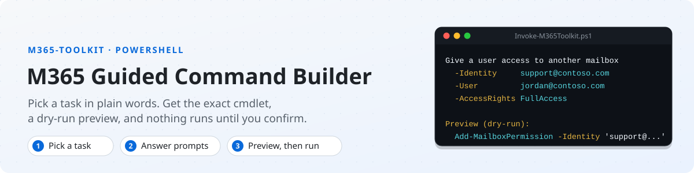
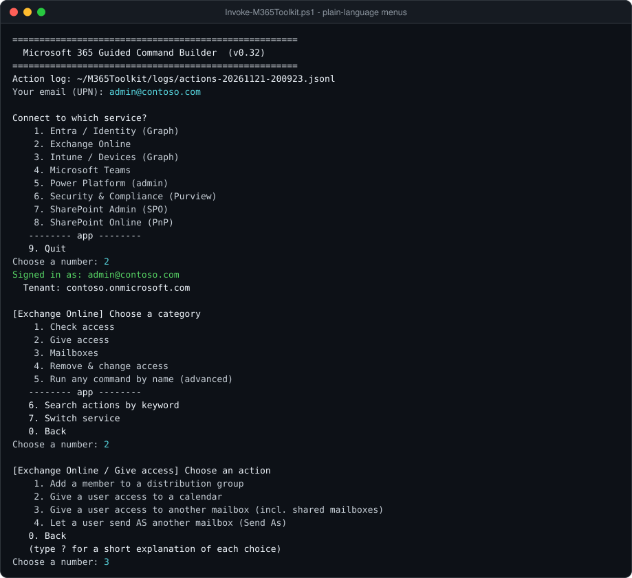
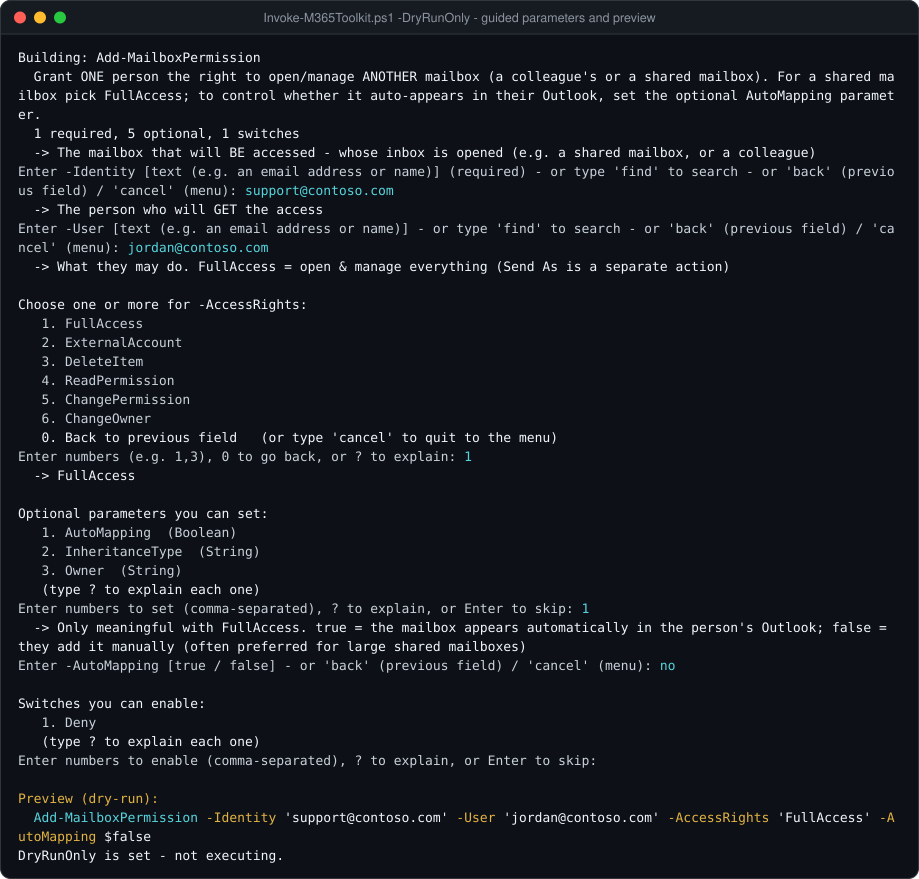
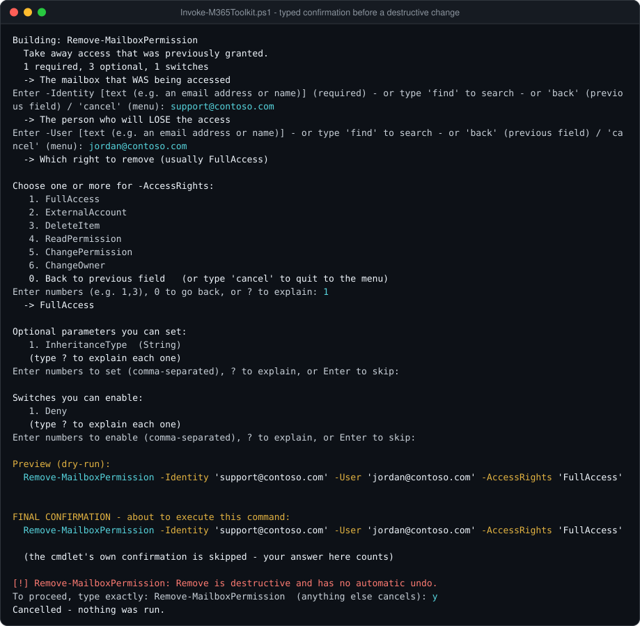

<p align="center">
  <picture>
    <source media="(prefers-color-scheme: dark)" srcset="docs/images/banner-dark.svg">
    <source media="(prefers-color-scheme: light)" srcset="docs/images/banner-light.svg">
    
  </picture>
</p>

<p align="center">
  <b>Run Microsoft 365 admin tasks from plain-language menus. No cmdlet names to remember.</b>
</p>

<p align="center">
  <a href="https://github.com/oracola91/m365-toolkit/actions/workflows/ci.yml"></a>
  <a href="LICENSE"></a>
  
  
  <a href="tests/"></a>
  <a href="SECURITY.md"></a>
</p>

# M365 Guided Command Builder

A plain-language, menu-driven PowerShell tool so the IT team can run Microsoft 365
admin commands **without memorizing cmdlet names or syntax**. You pick an action in
human language and the tool walks you through the parameters one at a time, shows you
the exact command it will run (dry-run), and only runs it when you confirm.

## What it does

- **Plain-language menus.** Pick a service, then a task such as "Give a user access to
  another mailbox". You never type a cmdlet name unless you want to.
- **Guided parameters.** It reads the real parameters off the cmdlet, asks for them one at a
  time, offers the allowed values as a numbered list, and can search the directory for a person.
- **Preview, then confirm.** It shows the exact command first. Nothing runs until you say
  yes, and destructive changes need the command name typed.

## Screenshots

<table>
  <tr>
    <td width="33%" valign="top"><a href="docs/images/screen-menus.svg"></a></td>
    <td width="33%" valign="top"><a href="docs/images/screen-builder.svg"></a></td>
    <td width="33%" valign="top"><a href="docs/images/screen-safety.svg"></a></td>
  </tr>
  <tr>
    <td align="center"><b>1. Pick a task</b><br>Services, categories and actions in plain words.</td>
    <td align="center"><b>2. Answer the prompts</b><br>Allowed values listed, then a dry-run preview.</td>
    <td align="center"><b>3. Confirm on purpose</b><br>Destructive changes need the name typed.</td>
  </tr>
</table>

<sub>Captured from the real script, with sign-in replaced by a stub and fictional
<code>contoso.com</code> data. No tenant was used. Click an image to see it full size.</sub>

## Features

- **Eight services.** Exchange Online, Security & Compliance (Purview), Entra / Identity
  (Graph), Intune / Devices (Graph), Microsoft Teams, SharePoint Online (PnP), SharePoint
  Admin (SPO) and Power Platform (admin). A module loads only when you pick its service.
- **Ready-made actions.** Check, give and remove mailbox and calendar access, Send As,
  distribution groups, shared mailboxes, a forwarding check, a leaver check, and user and
  group lookups in Entra. Full list: [docs/usage.md](docs/usage.md).
- **Run any command by name.** Every category menu has an advanced option that guides any
  cmdlet of the connected service in the same way.
- **Bulk from a CSV file.** Run one action for every row. Every row is checked before
  anything runs, and each row's outcome is saved to a results CSV.
- **Results you can use.** Show a lookup as a table, pick columns, or export to CSV.
- **Undo for the last change.** Offered when a safe revert can be built. You decide.
- **Help at every prompt.** Type `?` for allowed values or an explanation, and `find` to
  search the directory instead of typing an address.
- **Extend it with one row.** A new action is one entry in `$Actions`. See
  [Add a new action](#add-a-new-action-the-common-case) and
  [docs/how-it-works.md](docs/how-it-works.md).

## Requirements

- PowerShell 7+ on Windows, macOS or Linux, or Windows PowerShell 5.1.
- Microsoft's PowerShell module for the service you pick. If it is missing, the tool offers
  to install it for the current user from the PowerShell Gallery.
- An admin account with a Microsoft 365 role that allows the task. The tool signs in as you.
- SharePoint Admin (SPO) and Power Platform need Windows, because Microsoft ships those
  modules for Windows only. SharePoint Online (PnP) needs PowerShell 7.2+.

The full matrix is in [docs/platform-support.md](docs/platform-support.md).

## Quick start

```powershell
git clone https://github.com/oracola91/m365-toolkit.git
cd m365-toolkit

# Look around first. Preview mode never runs a change.
./Invoke-M365Toolkit.ps1 -DryRunOnly

# Normal run. Asks before running each command.
./Invoke-M365Toolkit.ps1
```

From the PowerShell Gallery (after the first Gallery publish, not available yet):

```powershell
Install-Script -Name Invoke-M365Toolkit -Scope CurrentUser
Invoke-M365Toolkit.ps1 -DryRunOnly
```

The first install asks to add your Scripts folder to PATH. An installed copy writes its logs
and CSV exports next to the script, in that Scripts folder.

Preview mode is not offline: it still signs in, reads the tenant for lookups and can offer
to install a missing module. The other switches (`-UseDeviceCode`, `-Transcript`) and the
pinned one-line remote run are in [docs/running.md](docs/running.md).

## Example: give a colleague access to a shared mailbox

1. Start `./Invoke-M365Toolkit.ps1 -DryRunOnly` and type your admin email.
2. Pick **Exchange Online**. After sign-in the tool shows the account and tenant it really
   got, and warns you if that differs from the email you typed.
3. Pick **Give access**, then **Give a user access to another mailbox (incl. shared
   mailboxes)**, then **Run once**.
4. Answer the prompts: the mailbox (`support@contoso.com`), the person who gets access
   (`jordan@contoso.com`), and `FullAccess` from the numbered list. Optionally set
   `AutoMapping` to `no`.
5. The tool shows the exact command:

   ```powershell
   Add-MailboxPermission -Identity 'support@contoso.com' -User 'jordan@contoso.com' -AccessRights 'FullAccess' -AutoMapping $false
   ```

6. In preview mode it stops here. In a normal run it asks `Execute it now? (y/n)`. For a
   removal it asks you to type the command name instead, and anything else cancels.

## Safety: what it never does on its own

- **It never runs a change you have not seen.** Every command is shown first and needs your
  confirmation. Removals and other destructive verbs, Invoke- actions such as a device wipe,
  mail forwarding, admin-role and mail-flow changes, and purge or force switches need the
  command name typed. A plain `y` does not pass.
- **It never goes past your own role.** Interactive, delegated sign-in only, with your own
  Microsoft 365 rights. There is no app-only or certificate sign-in.
- **It never runs local system commands.** "Run any command" lists only the connected
  service's own cmdlets, without sign-in or raw request cmdlets.
- **It never installs a module silently.** Installs come from the PowerShell Gallery only,
  after showing the name, version and author and asking you.
- **It never stays signed in.** On Quit it signs out of every service it connected to.
- **It never undoes on its own.** The undo for the last change is an option you pick.
- **It has no telemetry.** The script calls no web service of its own. Network traffic comes
  from the Microsoft modules you connect with.
- **It keeps a short action log, not a transcript.** Who, which service, the command, its
  target and the outcome, stored owner-only and deleted after 30 days. A full screen
  transcript is written only with `-Transcript`.

Details are in [docs/running.md](docs/running.md).

## Testing

The engine's logic is covered by Pester tests in [`tests/`](tests/) that run without a tenant (stub
cmdlets, scripted answers). Run them with:

```powershell
Invoke-Pester ./tests
```

GitHub Actions runs PSScriptAnalyzer and the tests on PowerShell 7 (Linux and Windows) and
Windows PowerShell 5.1 for every push and pull request. [`TEST-PLAN.md`](TEST-PLAN.md) lists the manual
checks that need a real tenant.

## Status, changelog and security

See [CHANGELOG.md](CHANGELOG.md) for what changed in each version, and
[SECURITY.md](SECURITY.md) to report a security problem.

Known limits, on purpose:

- Interactive, delegated sign-in only: no app-only or certificate auth for unattended runs.
  Adding it would need a service-account review first.
- Legacy AzureAD and MSOnline are retired and not supported; use the Graph services.
- An optional plain-English layer through an external AI service was considered. It would
  send directory data to a new party and turn model output into admin commands, so it needs
  a security review and IT approval before anyone builds it.

## Contributing

Issues and pull requests are welcome. Please report a security problem privately, as
[SECURITY.md](SECURITY.md) describes, not in a public issue.

Before you open a pull request, run the same checks as CI:

```powershell
Invoke-Pester ./tests
Invoke-ScriptAnalyzer -Path ./Invoke-M365Toolkit.ps1 -ExcludeRule PSAvoidUsingWriteHost
```

The most common change is a new action, which is one row:

### Add a new action (the common case)

Append one entry to `$Actions` in `Invoke-M365Toolkit.ps1`:

```powershell
[pscustomobject]@{
    Id        = 'mbx-hide-from-gal'  # required: unique and stable; actions are dispatched by Id, so never change it once shipped
    Service   = 'Exchange Online'
    Category  = 'Mailboxes'
    Label     = 'Hide a mailbox from the address list'
    Cmdlet    = 'Set-Mailbox'
    Prompt    = @('Identity','HiddenFromAddressListsEnabled')  # params to always walk (required OR optional)
    Preset    = @{ }                 # optional: values the action fixes, never prompted (e.g. @{ Type='Shared' })
    Help      = 'One-line description shown when building and via ? in the menu.'
    ParamHelp = @{ Identity = 'The mailbox to change' }        # optional: who -> whom, per parameter
}
```

That's it — the engine discovers and validates the parameters for you.

If a parameter has fixed values but the cmdlet hides them (common with Exchange Online
proxy cmdlets that expose things as `Object[]`), teach the tool by adding a row to
`$ParamHints` (keyed by parameter name), e.g. `AccessRights = @('FullAccess','SendAs',...)`.

## Documentation

| Page | What is in it |
|---|---|
| [docs/how-it-works.md](docs/how-it-works.md) | The four layers: services, the introspection engine, the action catalogue, the bulk runner |
| [docs/usage.md](docs/usage.md) | Every catalogued action, run once or in bulk, results and export, conveniences |
| [docs/running.md](docs/running.md) | All switches, the pinned remote run, modules, permissions and logs |
| [docs/platform-support.md](docs/platform-support.md) | Which service works on which platform and PowerShell version |
| [TEST-PLAN.md](TEST-PLAN.md) | Manual checks that need a real tenant |
| [CHANGELOG.md](CHANGELOG.md) | What changed in each version |
| [SECURITY.md](SECURITY.md) | How to report a vulnerability, and what is in scope |

## Licence

Released under the [MIT licence](LICENSE).
